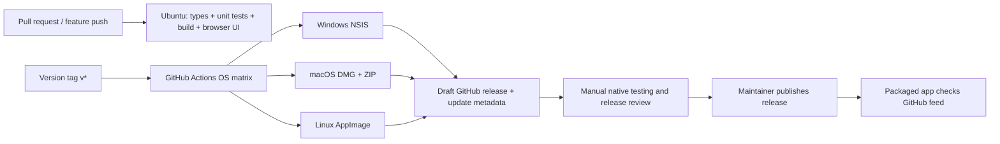

# Build and release deployment

The default workflow builds unsigned artifacts. Certificates, notarization, and trusted Windows signing are not configured. No release is automatically published from the draft.
