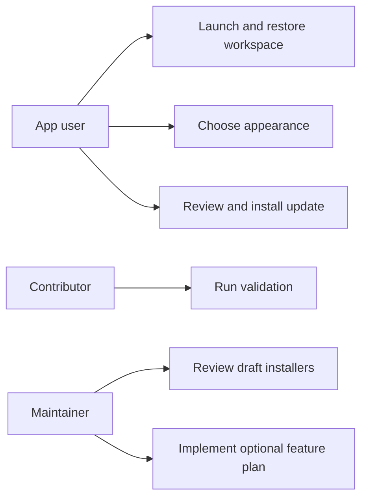

# Use cases

| Actor | Goal | Successful outcome | Failure behavior |
| --- | --- | --- | --- |
| App user | Launch application | Workspace appears after initialization | Retry screen or crash dialog |
| App user | Change theme | Renderer/native theme updates and preference persists | Toast reports save failure |
| App user | Open local file | OS dialog returns selected file | Cancel is harmless; errors show toast |
| App user | Navigate | Home, Dashboard, Settings change without server routing | Unknown hash shows not-found page |
| App user | Update app | Download progress, explicit restart, native installer | Error state; retry without fake completion |
| Contributor | Validate changes | Types, unit tests, build, mocked UI checks pass | CI report contains failure trace |
| Maintainer | Prepare release | Three-OS draft artifacts ready for manual validation | Failed jobs require investigation |
| Template adopter | Choose optional feature | Branch plan states requirements and test criteria | Plan never claims runtime support |

